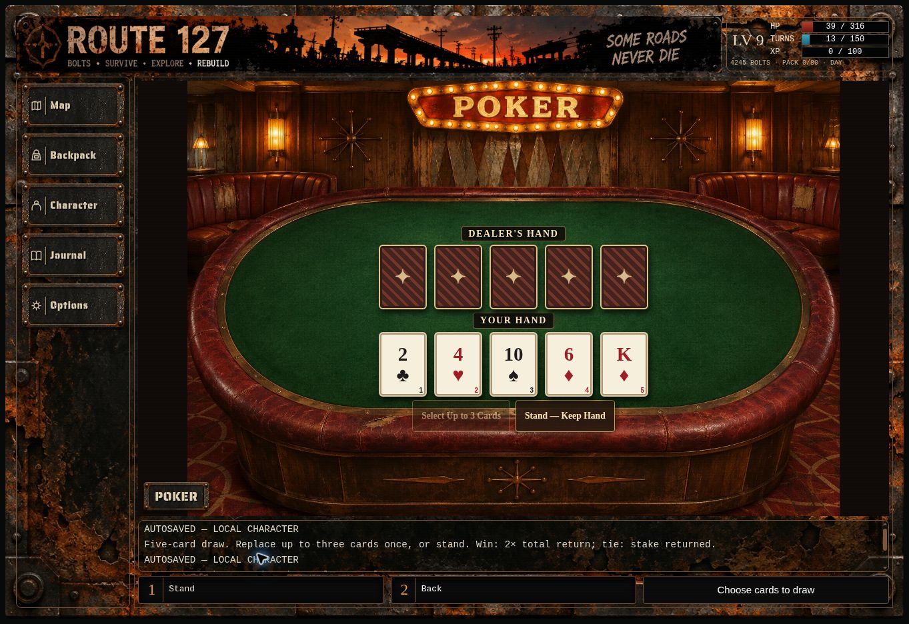
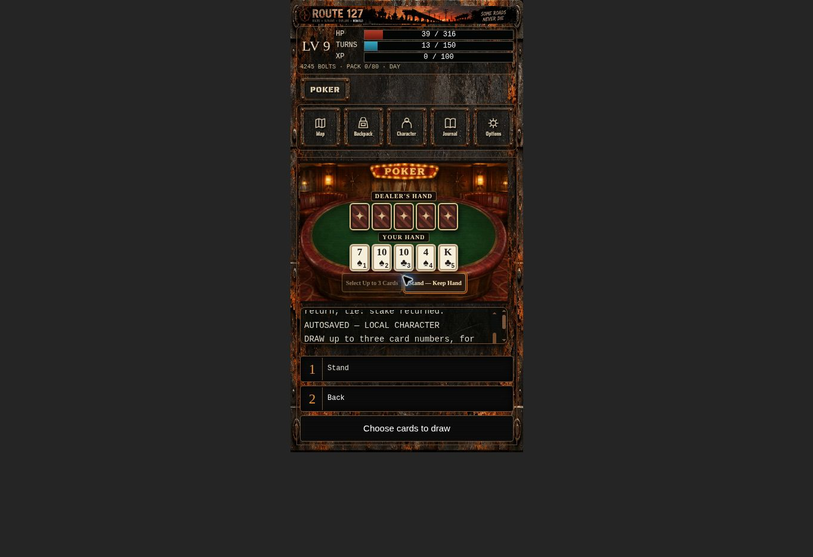
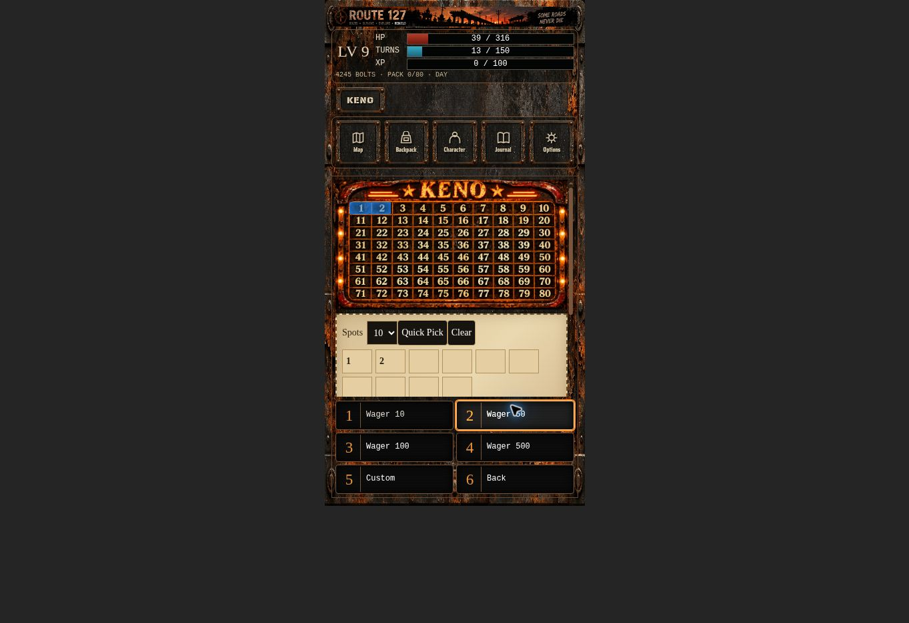
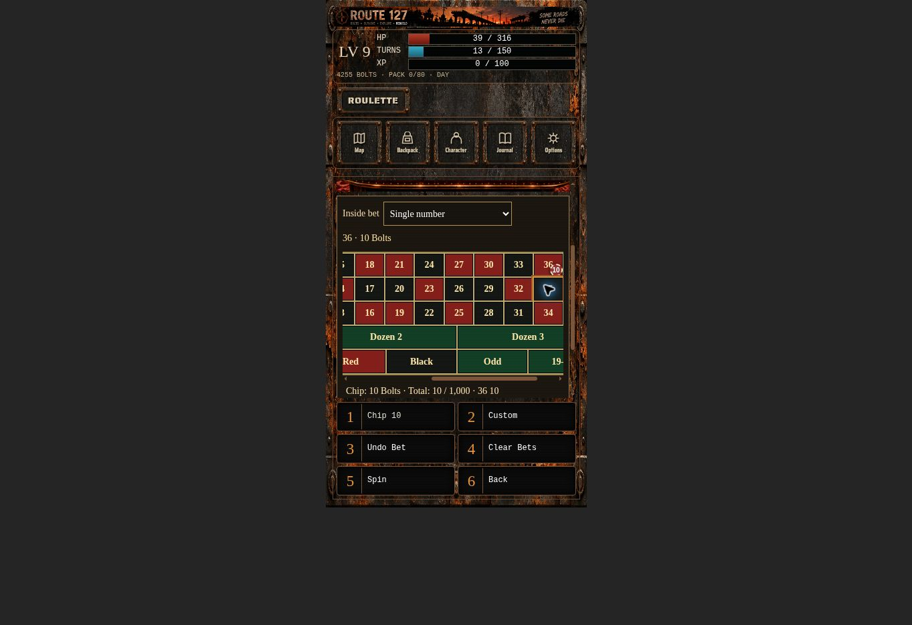
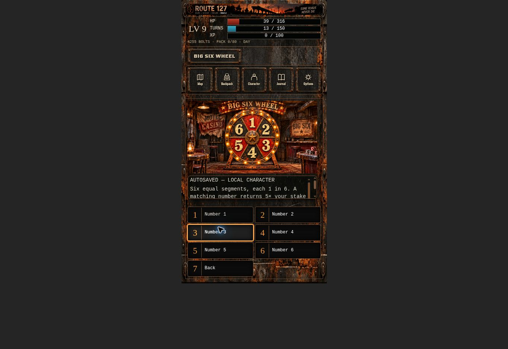

# Motel casino presentation repairs

## Changes

- Roulette rotor, ball orbit and spindle move together 1.2 percentage points right and 2.5 points up to center on the bowl in the existing background.
- Big Six wheel and pointer move up together 2.5 percentage points. Sizes, rotation targets and outcome logic are unchanged.
- Keno board coordinates and existing artwork are unchanged, following the owner's correction.
- Game nameplates show only POKER, SLOTS, BIG SIX WHEEL, KENO or ROULETTE. On phones, the duplicate artwork caption is hidden; the existing upper game-name plate remains visible and no longer obstructs the board.
- In the mobile casino, the artwork, betting/ticket panels and narrative share a scrollable content area; the complete action menu stays outside that scroller and inside the viewport. Leaving the game restores the ordinary interface structure. Desktop presentation remains unchanged except requested artwork/labels/alignment.
- Motel poker uses its own new 1960s–1970s Vegas-inspired table, with the existing five-card draw controls and card renderer. Seaport retains its Rusty Anchor artwork and name.

## Verification

`node route127/devtest/tests/motel-casino.cjs` and `ROUTE127_RELEASE=1 node route127/devtest/tests/motel-casino.cjs` PASS. These cover all five games, wagers/payouts, reload/duplicate-debit protections, zero-turn behavior and native graphical dispatch/return paths; now also assert game-only titles and the Motel-specific poker artwork/layout.

Actual browser QA used an isolated local DEVTEST character at 390×760 and desktop dimensions:

- Keno: 2-spot and 10-spot tickets; all six action buttons remain within the viewport (bottom 742px); Back returns to the casino. Board is not covered by a nameplate.
- Roulette: selected the far-right number 36 on the horizontally scrollable felt, saw the correct 10-Bolt chip, used Undo Bet and Back; all six actions remain visible. Desktop rotor/spindle visually centered on the background bowl.
- Big Six: adjusted wheel/pointer visually checked and all seven choices/Back reachable.
- Poker: new artwork and short title on desktop/mobile; dealt cards, selected a discard, drew a replacement, settled and returned through Back.

Preview fixtures are not included in production. No game-wide landscape feature, odds, payouts, prices, turn costs, save schema or Seaport poker artwork were changed.

## Poker asset

Saved production asset: `route127/devtest/assets/locations/casino/motel_poker_table.webp` (1536×1024). Created with the built-in image generation tool and encoded as WebP without resizing. Both game environments reference this shared asset.

Final generation prompt:

> Use case: stylized-concept. Asset type: production background artwork for a browser game's poker screen. Create a realistic cinematic post-apocalyptic 1960s–1970s Las Vegas motel casino poker table, wide landscape composition about 3:2. Player viewpoint slightly above and facing the table. A large elegant oval emerald-green felt poker table fills the central and lower 75% of the frame, with broad EMPTY uninterrupted playing surface in both the upper-middle and lower-middle so the game can overlay two horizontal rows of five playing cards. Worn oxblood padded leather rail, aged brass trim, scuffed dark walnut, restrained atomic-age detailing, faded amber casino bulbs and red velvet booths at the edges, weathered wood interior, patched upholstery, dust and patina but a cared-for gaming surface. Small warm vintage illuminated marquee at the very top reading exactly 'POKER', no other text. Rich warm amber lighting, deep green and burgundy, believable tactile materials, detailed realistic illustration matching a gritty Road Warrior / Book of Eli wasteland browser game. No people, hands, playing cards, chips, UI buttons, numbers, rules, barrel tables, ship imagery, pirate imagery, Rusty Anchor lettering, windows, lanterns, flags, goggles or watermarks. Keep the full table inside the image boundaries. This is the Motel casino's distinct poker table background, not a screenshot or interface mockup.
