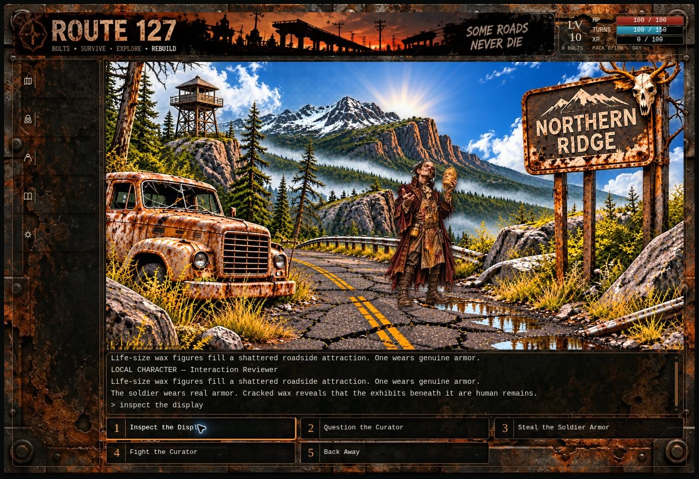
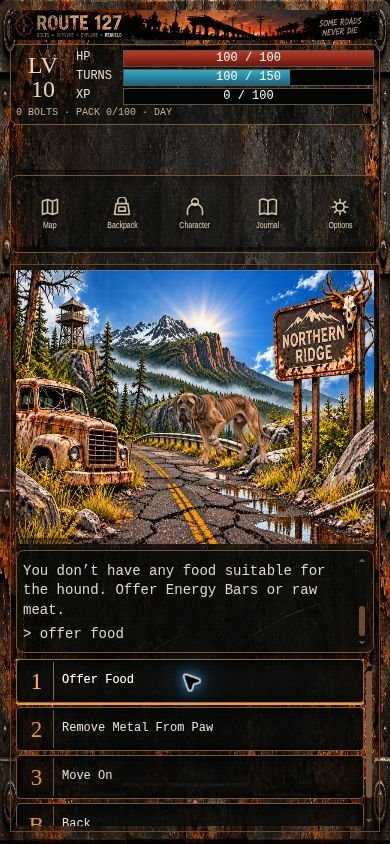
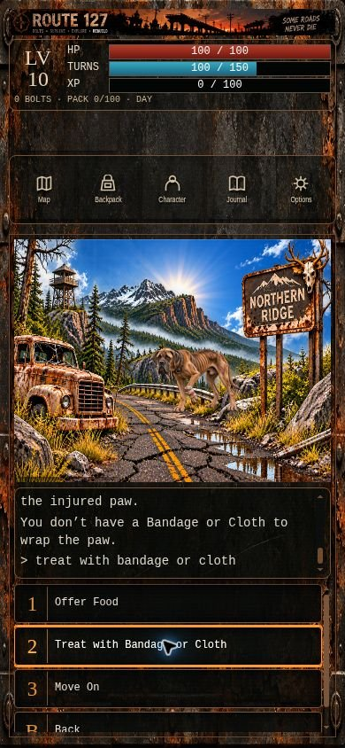

# DEVTEST encounter interaction audit

DEVTEST only. Baseline investigation started at main `899c3bb`; final repairs and tests include main `12a67b8` without reverting its turn-limit Options changes. No PLAYTEST files, backend, artwork/rendering, combat statistics, reward amounts, recipe costs, turn calculations or save namespace/schema changes. No full storyline playthrough.

## Coverage and results

| Measure | Result |
| --- | ---: |
| Unique registered encounters exercised, including legacy/inactive entries | 209 |
| Regional classifications covered | All eight |
| Distinct selectable actions exercised | 927 |
| Opening and discovered conditional menu states | 282 |
| Information actions | 86 |
| Of these, Inspect / Examine / Look actions | 46 |
| Item-dependent actions identified by actual requirement checks/results | 85 |
| Handler cases across terminal and graphical dispatch | 6,798 |
| Contract failures remaining in the matrix | 0 |

Every offered action runs through real `handleCommand` and `GraphicalUI.dispatch` paths with empty, stocked and one-item inventory profiles. Empty/partial profiles use deterministic high rolls; stocked profiles use low rolls. Conditional menus are discovered by replaying successful handler-produced flag states. Assertions cover visible results/new controls, invalid offered commands, unexplained fallbacks, inspection continuity and controls, unchanged travel/turn counters, no explicit lifecycle resolution, and no repeat reward farming. Derived "all discoveries claimed" eligibility can become true without dismissing the live scene; saved informational scenes remain resumable.

Information includes Inspect, Examine, Look, Peek, Read, Observe, Watch, Listen, Study and informational Investigate/Check. `coverage.json` records every action, inventory modes, dispatch paths, observed stages and case count. This deterministic matrix does not claim every possible quest flag, RNG value or item-provenance combination. No owner replay is required.

## Shared causes and repairs

- Baseline real-handler reproduction found 40 opening information-like selections leaving encounter stage: 38 road/node exits and two combat branches. Strict Inspect/Examine/Look accounted for 16. The intentional Factory Whistle ambush is preserved for review below.
- Legacy exclusive/default completion and lifecycle/WO7 completion treated successful information as encounter completion. A final shared DEVTEST interaction contract executes native inspection definitions and reward/lifecycle wrappers without road completion, retains controls/rereadable information, and suppresses repeat awards. First-time rewards and discoveries remain intact.
- Global normalization rewrote narrative `Talk …` actions to `small talk …`. Only bare `talk` remains an alias. Labels and handlers now share canonical normalization, including removal of cost suffixes that previously broke recipe buttons.
- Inventory helpers accepted zero stacks and over-removed insufficient quantities. Shared checks now record actual availability and refuse short-stack removal atomically. Failed requirements retain native feedback and add missing quantities or required/available Bolts. Shared material bundles list shortages before consuming anything.
- Literal wager `<AMOUNT>` menu buttons previously echoed without a usable result. They now open the existing numeric-entry flow with its range, balance and cancel behavior.
- Bone Collector and Traveling Taxidermist accept their existing named meats represented as material or consumable. Accepted names, protected/unique restrictions and prices are unchanged. Bone Collector shortages identify the items needed for the selected sale.
- Bone Flags now separates Inspect from the existing Fight choice. Inspect reveals the snare and retains choices; subsequent Fight keeps the original inspected combat advantage. Combat statistics/rewards are unchanged.

## Known reports

**Wax Museum Collector (`east:17`): resolved.** Actual graphical Inspect displays the human-remains discovery, retains all five choices and pending scene, and leaves the disposable character's 100 turns unchanged. This reproduces and repairs the reported road exit.

**Limping Hound (`early:50`): verified under the shared command/menu repairs.** Current DEVTEST already contained correct native missing-food text; its exact accepted foods remain unchanged. Focused tests cover all seven accepted foods, no food, zero quantity, an unaccepted potato, Bandage/Cloth alternatives and missing treatment. Failed food/treatment keeps the scene and controls. Mobile displays the actual suitable-food and missing-Bandage/Cloth explanations.

## Targeted checks

- Desktop: real Collector Inspect button, readable discovery, five choices retained, no input popup or movement.
- Mobile: 390 × 844 CSS-pixel iframe; real Hound food/treatment buttons; readable shortage explanations with controls available and no overlapping dialog.
- Tire Maze: real mounted graphical UI opens its existing maze and directional/Leave controls. This is browser-tested because the offline DOM fixture does not mount its scene figure.
- `node route127/devtest/tests/encounter-interactions.cjs` — 6,798 cases passed after recovery, with the same coverage counts as the initial completed run.
- `node route127/devtest/tests/encounter-interaction-requirements.cjs` — Collector, Hound, quantities 0/1/9/10, consumable meat trade, atomic removal and inspected Bone Flags combat advantage passed.
- Existing `local-character-isolation.cjs`, `scene_art_containment.cjs`, `roadside_composition.cjs`, `waiting_for_dawn.cjs` — passed.
- Syntax and `git diff --check` — passed.

Screenshots use isolated local DEVTEST review states, no public community service or owner save.

## Owner review exception

**Factory Whistle (`early:194`) — INVESTIGATE THE SIGNAL** intentionally starts the existing security-drone ambush. It is not an Inspect action. Its combat/story consequence remains unchanged and it is excluded from nonterminal information classification. Owner review: decide whether to clarify its wording or split the interaction in a later change; this audit does not invent a new outcome.

No merge or deployment to public PLAYTEST is included.
