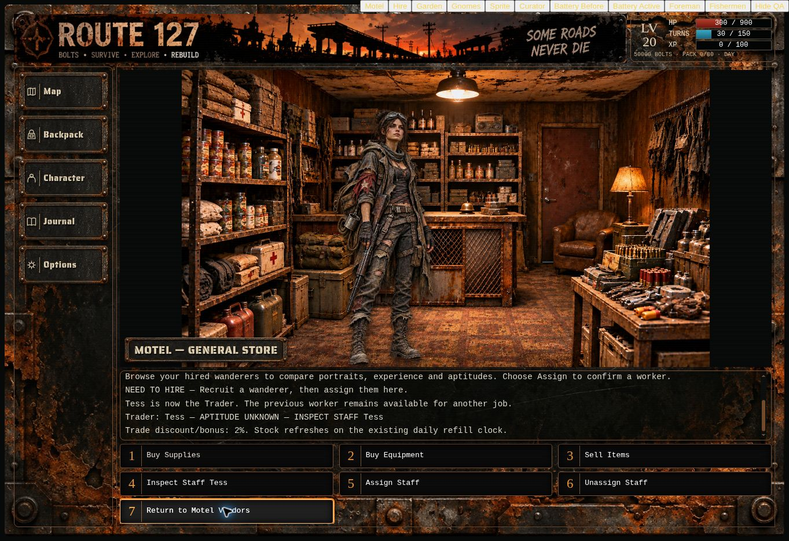
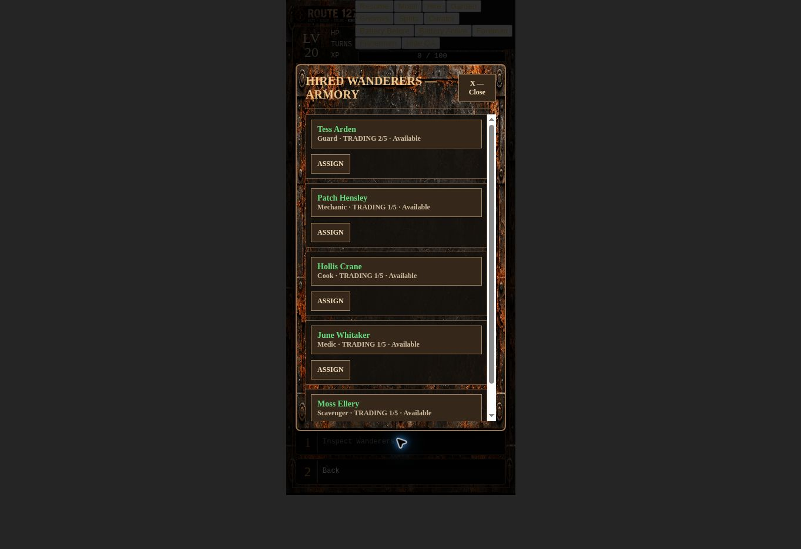
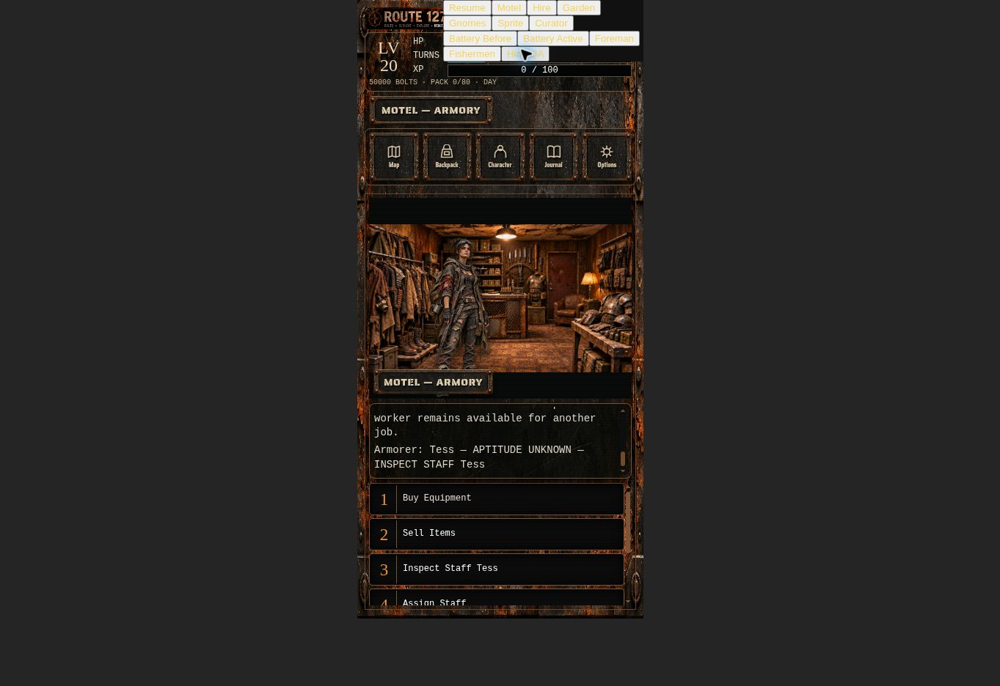

# Gameplay, rendering and Motel integration repairs

## Repairs

- Shared direct/numbered/graphical combat item handlers consume healing and return to combat without retaliation. Healing values, enemy stats, attack retaliation and bare-knuckle item restrictions are unchanged.
- Shared cinematic renderer measures the existing contained foreground and clips backdrop layers to its bounds. Exposed margins use the existing dark background. No artwork, dimensions, positions or saved layouts were changed; regional sprite scenes remain excluded.
- Question the Curator uses the existing informational interaction path: dialogue and encounter choices remain available without completing the road turn.
- Battery Cart hides the Corvette battery choice until the existing active/found/level quest requirements permit it. Delivered, completed and already-carried/claimed flags prevent duplicates. Ordinary salvage remains available.
- Common equipment resale is excluded from Rusty and wanderer stock additions. Existing Common resale entries are cleaned on load and stock/menu access. The existing Solace buyback policy continues to retain higher rarities. Generated merchandise, sale values, protected equipment and native Seaport/Motel sale behavior are preserved.

## Targeted regression results

`node route127/devtest/tests/gameplay-rendering-repairs.cjs` — PASS:

- 108 healing cases: four Factory bosses, Yardman, Fishermen, Motel arena, coastal and road fights; four medicines through direct, numbered and graphical dispatch. Exact HP, consumption, combat/menu state, unchanged enemy and turns checked. Normal attack retaliation and bare-knuckle healing prohibition also pass.
- Curator graphical dispatch: intended dialogue, encounter choices, pending travel and turns preserved.
- Battery Cart: inactive/active/found quest, ordinary salvage, delivered/completed states and duplicate protection.
- Rusty and Solace Common/Uncommon/Rare/Epic sales, cash and retained higher-rarity stock; legacy save cleanup; Seaport/Motel staffed store sales; wanderer generated Common stock and separate resale cleanup.
- Cinematic containment geometry and regional sprite exclusion.

`node route127/devtest/tests/motel-casino.cjs` — PASS (all five games, settlement/return dispatch, wagers, payouts, reload/duplicate-credit protections and zero-turn behavior).

`node route127/devtest/tests/motel-settlement.cjs` — PASS.

Desktop browser verification used an isolated local DEVTEST fixture with actual graphical controls: Garden dark side margins and internal sky; full regional background restored for a sprite encounter; Curator dialogue with choices retained; Foreman and Fishermen Bandage healing from 300 to 525/900 HP with unchanged enemy HP, 30 turns and combat choices restored. Mobile rendering verification was skipped at the owner's request.

## Motel integration and owner-authorized PLAYTEST promotion

The owner subsequently requested the pending repairs and current Motel work be published to PLAYTEST as well as DEVTEST.

- Leave Motel offers only its three existing road destinations (four turns each) and Back; the old roadside Deep End entrance is retired.
- The Pool is now The Deep End. The current arena, roster, artwork, spectator and tournament mechanics are retained.
- The Lounge's Gamble entrance opens Poker, Slots, Big Six, Keno and Roulette; Back returns to the Lounge.
- All five staffed Motel shops share Seaport's roster picker, portrait/aptitude dossier and assignment confirmation path. Shop sprites and vendor names read the settlement-specific assignments. Rani remains outside staffing.
- The three targeted suites above also PASS with `ROUTE127_RELEASE=1`, executing the actual public PLAYTEST entry. Public login, cloud bootstrap, QA restrictions and live bulletin-board API are retained; no DEVTEST sample board was promoted.
- Actual desktop graphical checks cover recruitment, roster inspection/assignment/unassignment, assigned shop sprite, save/reload restoration, road-only exit choices and Motel navigation. The mobile 390px viewport shows the existing responsive roster/dossier and assigned Armory worker. The PLAYTEST local save reload restores the worker.

No artwork assets, artwork sizing, road costs or combat balance were changed. No extended gameplay audit was performed.

