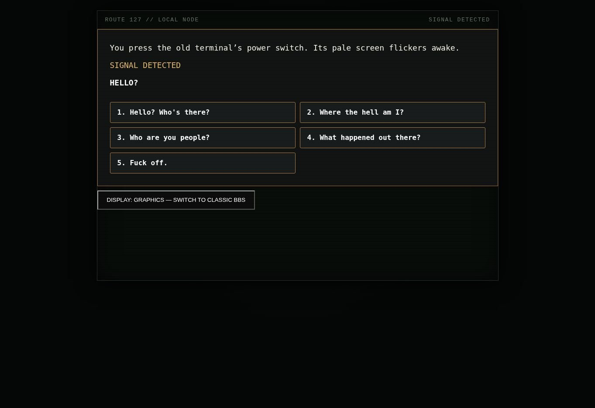
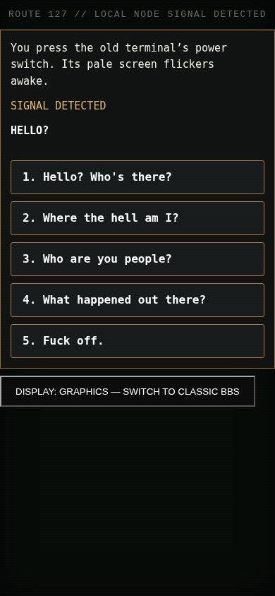
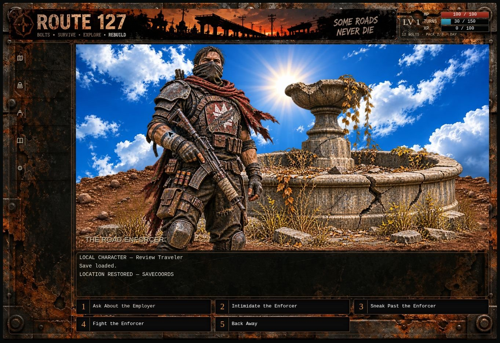
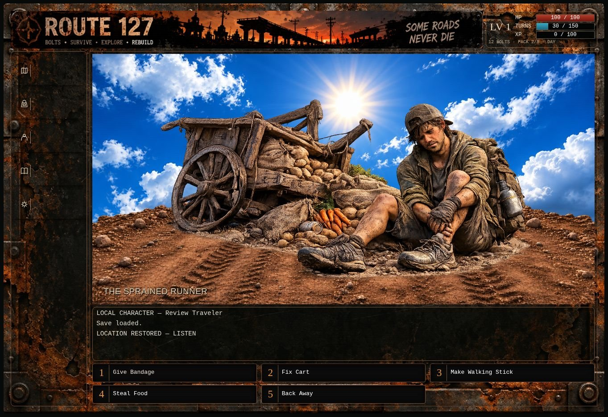
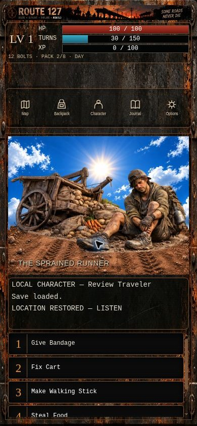

# DEVTEST terminal introduction and scene containment

## Terminal dialogue

The greeting now offers five inline white-lettered buttons. The selected exchange remains visible until Continue transmission. Subsequent pages preserve the two voices, failed transfer, Tomorrow Project, Solace coordinates and Relay objective. Log coordinates uses the existing departure/progression handler. Naming, character creation and the save schema are unchanged.

| Player response | Terminal answer |
| --- | --- |
| Hello? Who's there? | Holy shit. Someone actually answered. |
| Where the hell am I? | Somewhere you don't want to stay. |
| Who are you people? | We're trying to help. That's all you need to know right now. |
| What happened out there? | How much time do you have? Because we don't have much. |
| Fuck off. | Well, that's a hell of a way to greet your rescuers. |

All five choices converge on the same introduction and main quest.

## Scene artwork

The shared stylesheet's late `object-fit: cover` rule fills the frame by cropping primary illustrations. Saved editor layouts also bypass several earlier per-scene fixes because those fixes exclude layout units. DEVTEST now applies `contain` to primary scene images and bounds their saved display boxes inside the art frame using the existing geometry helper. Saved layout data, combat sprites, background layers and night filters remain intact. Square artwork such as Ridgeline has side space rather than losing its top and bottom.

Reported examples checked: Road Enforcer, Shattered Silo, Hollow Statue, Ridgeline and Sprained Runner.

## Targeted validation

- `node tests/intro_dialogue_choices.cjs`: all five paths in graphics and classic modes; no terminal reply dialog or typewriter calls; player-paced continuation; no invalid-input trap; existing coordinate/departure progression; naming regression.
- `node tests/local-character-isolation.cjs`: local intro, autosave, Continue, reset and isolation.
- `node tests/scene_art_containment.cjs`: oversized saved boxes for all five reported images are bounded without rewriting saved layouts; overlay sprite geometry is unaffected.
- `node tests/roadside_composition.cjs`: existing regional, sky/road and day/night composition checks.
- JavaScript syntax and `git diff --check` passed.
- Local browser preview: desktop dialogue and scene artwork, plus 390px mobile dialogue and Sprained Runner. Screenshots use isolated preview checkpoints, not the owner's save. The mobile capture is a 390px iframe viewport, not physical-device testing.

All changed production source paths are under `route127/devtest`. No public PLAYTEST files changed. No full playthrough, merge or deployment performed.

## Screenshots

