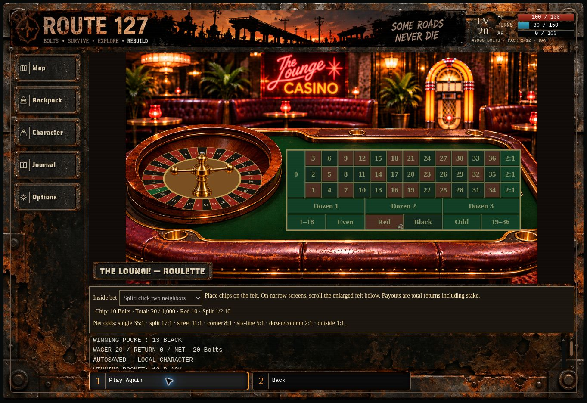
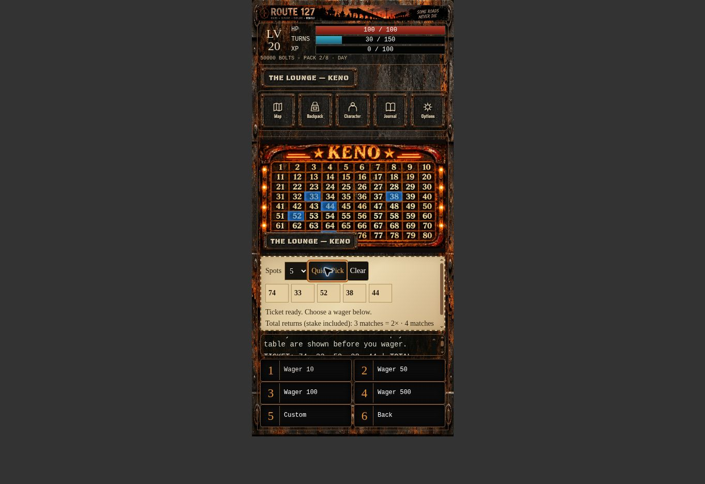

# The Lounge casino — DEVTEST only

The Abandoned Motel Lounge now offers Gamble. The casino has exactly six choices: Poker, Slots, Big Six Wheel, Keno, Roulette, Back. Back returns to the Lounge. Every changed production file is under `route127/devtest`. No PLAYTEST, backend, turn balance or settlement services changed. No merge or public deployment was performed.

## Implementation

Poker uses the existing R6 five-card draw engine and Seaport graphical cards/table. Motel labels identify Poker and Dealer; Seaport labels remain intact. Slots use the existing weighted draw/payout function (including its boosted winning odds), fixed stakes and repeated-strip translation technique. The supplied strip's source rows are mapped to the cabinet's printed paytable.

All games use `r6Wager`, `r6Settle`, `r6CasinoSave` and the existing character-wide R11/per-round journals. Instant outcomes are committed with the debit before settlement or animation. Recovering an active instant round settles that saved outcome, without rerolling; an active Poker round keeps its deck and cards. The native ledger prevents replayed credits/debits. Amounts must be affordable safe integers. Non-slot wagers are capped at 1,000 Bolts, with a combined 1,000 cap for Roulette. Slots allow only 10/20/50. No All In. Gambling spends zero turns and cannot commit wagers while out of turns.

Animations only depict the committed outcome. Big Six keeps its pointer stationary. Roulette generates a 37-pocket SVG rotor in the authentic European order, with correct colors and brass dividers; the supplied handle sits above it and the supplied ball travels in the opposite direction before meeting the winning pocket. Reduced-motion users receive the final pose.

The Keno board was visually checked: its printed 1–80 grid is correct. Highlight overlays align with those cells. The Roulette artwork's printed columns are incorrect for standard column bets, so its felt has an authoritative programmatic overlay. Mobile additionally offers an enlarged, horizontally scrollable felt. Inside-bet mode selects singles, splits (two neighboring numbers), streets, corners (lowest number), and six-lines (lowest row). All placed inside/outside bets are represented by chips. Undo and Clear operate before commitment.

## Payouts

All multipliers below are **total returns including stake**; missing Keno entries pay zero.

### Slots

| Symbol | Weight | Total return |
|---|---:|---:|
| Wrenches | 30% | 10× |
| Cherries | 25% | 18× |
| Car | 20% | 28× |
| Dice | 12% | 50× |
| Gas Pump | 10% | 70× |
| Record | 3% | 300× |

Three identical symbols are required. The existing shared boosted-winning function remains authoritative; the weights are the base symbol weights, not the final win probabilities.

### Poker and Big Six

Poker returns 2× on a win, 1× on a tie, zero on a loss, using the existing engine. Big Six has six equal-sized segments: each number has probability 1/6. A win returns 5× (4:1 net), giving expected return 5/6 = 83.3333% and house edge 16.6667%. The equally sized visible sectors are not secretly weighted.

### Keno

The draw selects 20 distinct numbers uniformly without replacement from 1–80. For a ticket with `s` spots, `P(h matches) = C(s,h) C(80-s,20-h) / C(80,20)`. The expected return sums each probability times its total-return multiplier.

| Spots | Paying matches → total return | Expected return |
|---:|---|---:|
| 2 | 2 → 12× | 72.1519% |
| 3 | 2 → 2×; 3 → 42× | 86.0273% |
| 4 | 2 → 1×; 3 → 4×; 4 → 100× | 69.1966% |
| 5 | 3 → 2×; 4 → 20×; 5 → 800× | 92.5657% |
| 6 | 3 → 1×; 4 → 7×; 5 → 50×; 6 → 1,600× | 69.0743% |
| 7 | 3 → 1×; 4 → 2×; 5 → 20×; 6 → 400×; 7 → 7,000× | 91.5794% |
| 8 | 4 → 2×; 5 → 10×; 6 → 50×; 7 → 1,000×; 8 → 10,000× | 66.8281% |
| 9 | 4 → 1×; 5 → 5×; 6 → 25×; 7 → 200×; 8 → 4,000×; 9 → 25,000× | 68.6914% |
| 10 | 5 → 2×; 6 → 20×; 7 → 80×; 8 → 500×; 9 → 5,000×; 10 → 100,000× | 57.0869% |

This casino-style table has different expected returns by ticket size, as shown. The complete applicable table is shown on the ticket before placing a wager. Quick Pick is optional; manual numbers remain editable, unique and in range. Clear invalidates the ticket until valid numbers are entered.

### Roulette

| Bet | Numbers covered | Net odds | Total return |
|---|---:|---:|---:|
| Single | 1 | 35:1 | 36× |
| Split | 2 | 17:1 | 18× |
| Street | 3 | 11:1 | 12× |
| Corner (including first four) | 4 | 8:1 | 9× |
| Six-line | 6 | 5:1 | 6× |
| Dozen / column | 12 | 2:1 | 3× |
| Red / black / odd / even / low / high | 18 | 1:1 | 2× |

Each pocket has probability 1/37. Each supported individual bet has expected return 36/37 = 97.2973%. Zero loses ordinary outside bets. Multiple bets settle together from their combined stake, with each winning chip returning its stake and net win.

## Verification

`node route127/devtest/tests/motel-casino.cjs` executes the complete actual DEVTEST script chain. It verifies native Poker deals/stand, active-card reload preservation, slot stakes and paytable returns, each Big Six outcome, every Keno spot count and its probability mass/expected return, every defined Roulette bet against every one of the 37 pockets, all 37 committed Roulette spins with reloads, cap/affordability/undo/clear/zero-turn protections, all five actual graphical dispatch/return paths, and simulated closure after the debit checkpoint but before settlement for all four instant games. Those interruptions restore the committed result and credit it exactly once.

`node route127/devtest/tests/motel-settlement.cjs` and `node route127/devtest/tests/seaport-casino-runtime.cjs` pass. The former now expects the authorized Gamble option; the latter confirms existing Seaport slots, wagers, returns, persistence and turns.

Browser checks used an isolated local preview of the current checkout. Desktop checks covered Slots/reel alignment and a real wager, Big Six layers, Keno spot editing/Quick Pick and a draw, Roulette felt/split chips and a real spin. A 390×844 iframe verified the responsive layout, Roulette chip placement and settlement, Keno ticket editing/Quick Pick, and Poker native deal/stand/reveal. Turns remained 30. No extended wasteland playthrough or hosted/public gameplay was performed. Screenshots are representative local-preview observations, not evidence of a hosted release.

