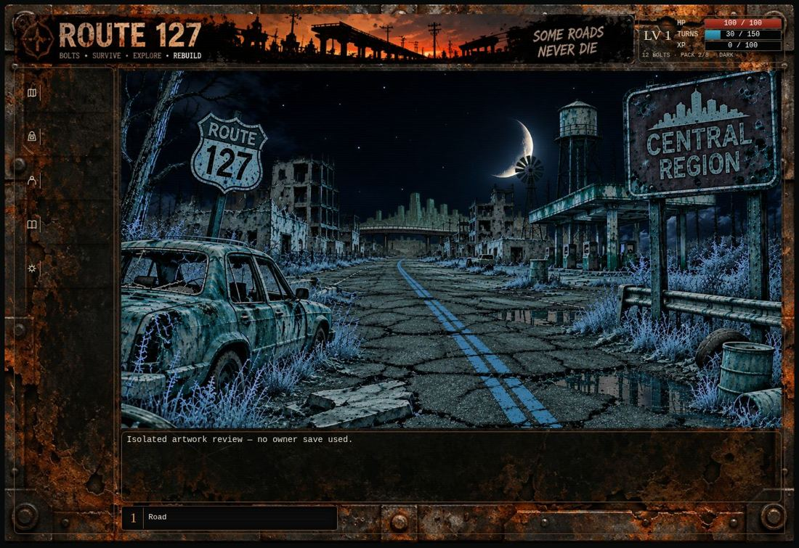
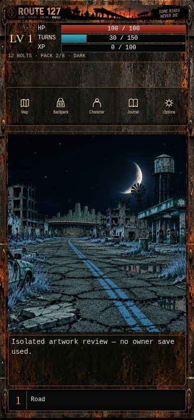
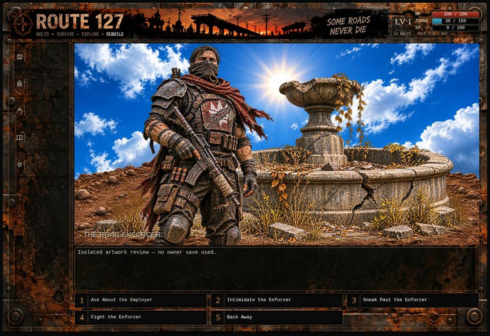

# DEVTEST regional sizing regression repair

PR #192 applied encounter containment to the shared primary image node. Regional terrain also uses that node, so the new important rule overrode its existing cover fit and left sky-only strips on both sides.

The containment selector now excludes `/assets/regions/`, including original regional images and transparent overlays. The saved-box clamp excludes those images too. Regional CSS, images, sky layers, lighting and saved layout values are unchanged. Dedicated encounter/location artwork keeps the uncropped fit.

Validation:
- Scene containment test: five reported encounter boxes still bounded; all eight regional saved geometries and sprite overlay scales preserved.
- Existing roadside composition test: nine encounters, Central/Causeway, day/night passed.
- Local browser preview: all eight regional overlays loaded with computed `object-fit: cover`; Enforcer loaded with `contain`.
- Desktop and 390px mobile Central night screenshots confirmed terrain fills its viewport. Mobile review used an iframe viewport rather than a physical device.
- Syntax and diff checks passed. No full playthrough, public PLAYTEST edits, merge or deployment.

