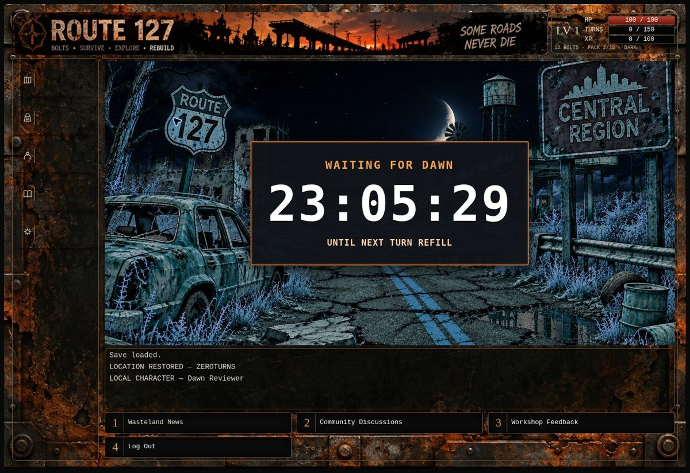
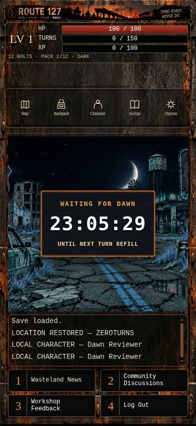
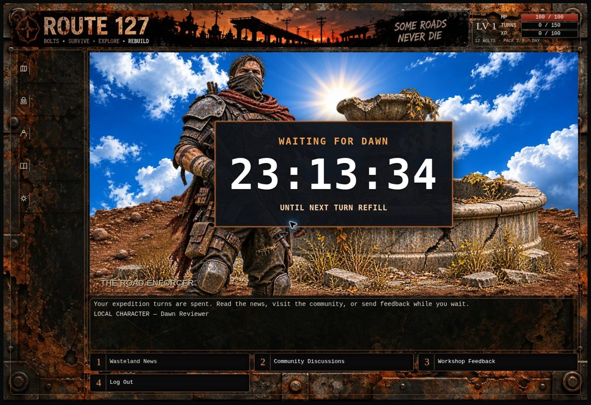

# Waiting for Dawn — DEVTEST only

The zero-turn screen uses the existing scene and sidebar. A dark metal clock overlays the scene, displays HH:MM:SS from `player.flags.nextRefillAt`, and uses the existing one-second refill timer. It creates no separate deadline. Entering the waiting screen saves through the existing local autosave. Refresh, Continue, and browser reopening use the persisted deadline.

Exactly four waiting actions: Wasteland News, Community Discussions, Workshop Feedback, Log Out. Log Out calls the existing save and return-to-title path; failed saves leave the session open. Workshop Feedback is also in Options during normal gameplay.

The existing suspended stage renders synchronously beneath the overlay, preserving regional terrain, dynamic sky, encounter artwork and saved placements. Refills use the original calculation and restore the suspended stage. A sidebar panel opened from waiting closes safely at refill so its old snapshot cannot restore a stale zero-turn stage. Final paid encounters remain resolvable before the completed action enters waiting.

## Local community restrictions

DEVTEST retains its local sample board and feedback preview, with no public-service calls. Zero-turn characters can read topics/replies but cannot create, reply, edit or remove public content. The local request layer rejects stale form submissions as well as hiding controls. The normal ten-minute posting/reply cooldown is unchanged. Feedback bypasses the public discussion gate and spends no turns.

**Public release requirement:** before promoting this feature to PLAYTEST, enforce the zero-turn mutation gate on the public backend using authoritative player turns for create/reply/edit/delete and other public modifications, including stale requests. Keep reads and private feedback available, retain existing cooldown/security rules, and test the server gate directly. This assignment changes no public backend or PLAYTEST files; the local adapter is not a public security boundary.

## Targeted checks

- `node tests/waiting_for_dawn.cjs`: exact four choices; saved timestamp and second-by-second time arithmetic; fresh engine reload; all menu actions; zero-turn reading; stale create/edit/remove rejection; normal posting cooldown; local feedback with network access forbidden; Options return state; saved logout/Continue; original +30 refill and stage restoration.
- `node tests/camp-community.cjs`: local news/thread navigation, read-only restrictions even in unlimited testing mode at zero turns, feedback, normal posting. Updated the retired camp-popup expectations for the new inline menu.
- `node tests/local-character-isolation.cjs`: autosave, Continue, reset and DEVTEST isolation.
- `node tests/scene_art_containment.cjs` and `node tests/roadside_composition.cjs`: existing image geometry and layered regional/day/night composition unchanged.
- JavaScript syntax and `git diff --check` passed.

Browser verification used a disposable preview character, never the owner's save. The clock remained over Central terrain on desktop and at 390px; all four mobile actions fit without covering the scene clock. Refresh went from 23:07:05 to 23:07:03 instead of restarting. Log Out returned to Continue/Reset Character, and Continue restored the character and deadline. Read-only discussion pages and local feedback submission worked. Options feedback worked both with and without turns. A controlled 15-second deadline refilled 30 turns, removed the clock and restored travel choices automatically. The Enforcer retained its complete contained artwork underneath the daytime clock. Mobile review was an iframe viewport, not physical-device testing.

No owner replay, full playthrough, merge or deployment performed. Production source changes are limited to DEVTEST presentation/community code; turn allocation, refill calculation, saves, gameplay and artwork files are untouched.

