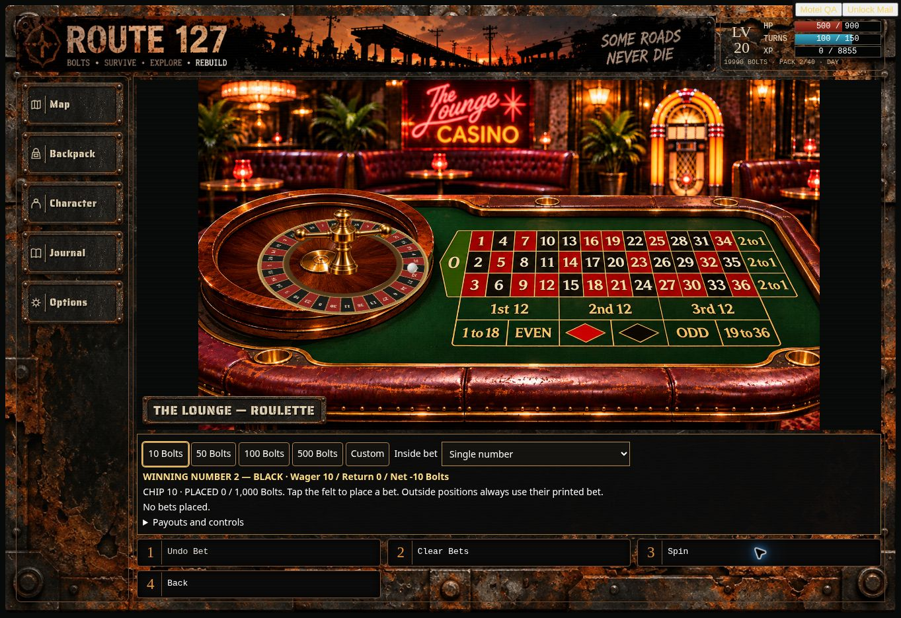
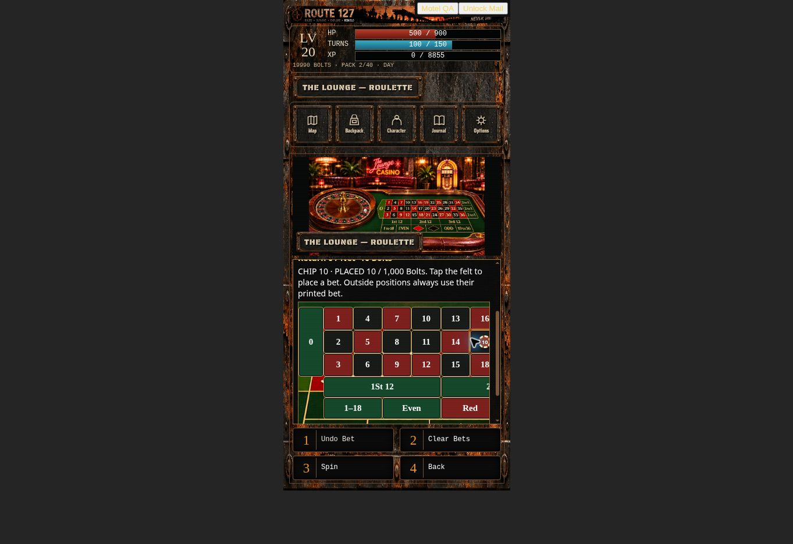
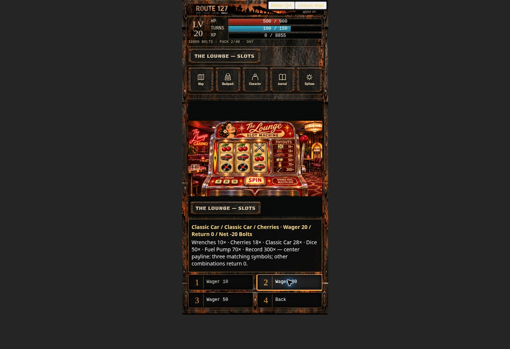
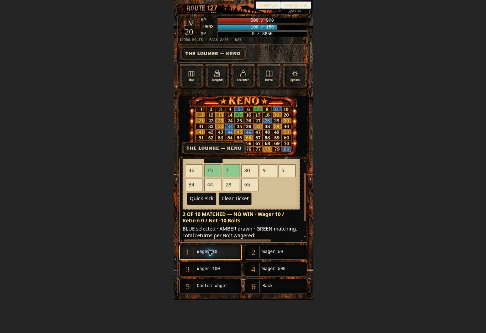
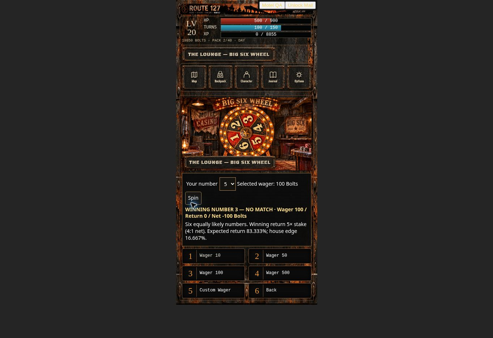

# The Lounge casino — DEVTEST review

The Lounge now has **Gamble**, leading to Poker, Slots, Big Six Wheel, Keno, Roulette and Back. Back returns to the Lounge. The casino was implemented in that order, with targeted handler and graphical checks before moving on.

## Existing systems and artwork

Poker uses the existing Seaport five-card draw engine, deck, dealer strategy, ranking, payouts and animated table. Motel labels say Poker/Dealer; Seaport labels and behavior remain unchanged. The reused table image retains its printed Rusty Anchor sign.

Slots use native symbol draws, the existing boosted payout function, native wagering and the existing casino journals. The cabinet's transparent openings show independently animated strips behind its dividers. The supplied strip's order is mapped explicitly: wrenches, cherries, car, dice, pump, record correspond to native tiers 1–6. The cabinet's first paytable icon depicts loose hardware while the strip uses wrenches; that icon is overlaid with the wrench cell from the same supplied strip. No artwork was generated or duplicated.

All financial games use the existing `r6Wager`, `r6Settle`, per-round save and character-wide `r11` casino journal. New-game outcomes are stored with the native debit before settlement; an interrupted debit is resumed from its stored outcome. Animations never determine or resettle a result. Uncommitted Roulette chips do not deduct currency. All gambling uses zero expedition turns, with existing Waiting for Dawn restrictions retained.

Artwork references remain at their supplied locations:

| File | Existing repository path |
|---|---|
| Casino entrance | `route127/devtest/assets/locations/motel_casino.png` |
| Slot cabinet | `route127/devtest/assets/locations/casino/motel_slot_machine.png` |
| Slot strip | `route127/devtest/assets/locations/casino/motel_slot_reel_strip.png` |
| Big Six mounting | `route127/devtest/assets/locations/casino/motel_bigsix_background.png` |
| Big Six wheel | `route127/devtest/assets/locations/casino/motel_bigsix_wheel.png` |
| Fixed pointer | `route127/devtest/assets/locations/casino/motel_bigsix_pointer.png` |
| Keno board | `route127/devtest/assets/locations/casino/motel_keno_board.png` |
| Roulette table | `route127/devtest/assets/locations/casino/motel_roulette_background.png` |
| Roulette spindle | `route127/devtest/assets/locations/casino/motel_roulette_handle.png` |
| Roulette ball | `route127/devtest/assets/locations/casino/motel_roulette_ball.png` |
| Reused Poker table | `route127/devtest/assets/locations/seaport_pirates_poker.png` |

## Wagers

Slots offer 10/20/50 Bolts. Poker and the new games offer 10/50/100/500 and Custom, capped at 1,000. No All In. Roulette caps all chips together at 1,000 per spin. Invalid, fractional, insufficient-funds and missing-ticket actions provide feedback without a debit. Roulette inside-bet selection and the mobile felt are interactive betting surfaces, not navigation menus. Its standard actions are Undo Bet, Clear Bets, Spin and Back.

## Big Six

Each of the six equal sectors has probability **1/6**. A correct number returns **5× total**, including stake (net 4:1). Expected return is **83.333333%**; house edge **16.666667%**. The pointer is stationary. Stored rotation angles put it inside the selected outcome's actual printed sector.

## Keno

Twenty unique numbers are drawn without replacement from 1–80. Tickets select 2–10 unique numbers. The supplied board has the correct 1–80 sequence. Blue highlights selections, amber reveals draws sequentially, and green marks matches on the board and paper ticket.

This fixed table uses the published [Ohio Keno base paytable](https://www.ohiolottery.com/games/keno/) as a reference, normalized to **total returns per Bolt**. It does not include Booster, progressive jackpots or real-money caps. Zero below means no return.

| Spots | 0 hits | 1 | 2 | 3 | 4 | 5 | 6 | 7 | 8 | 9 | 10 | Expected return |
|---:|---:|---:|---:|---:|---:|---:|---:|---:|---:|---:|---:|---:|
| 2 | 0 | 0 | 11 | — | — | — | — | — | — | — | — | 66.1392% |
| 3 | 0 | 0 | 2 | 27 | — | — | — | — | — | — | — | 65.2142% |
| 4 | 0 | 0 | 1 | 5 | 72 | — | — | — | — | — | — | 64.9439% |
| 5 | 0 | 0 | 0 | 2 | 18 | 410 | — | — | — | — | — | 64.9951% |
| 6 | 0 | 0 | 0 | 1 | 7 | 57 | 1100 | — | — | — | — | 64.7920% |
| 7 | 0 | 0 | 0 | 1 | 5 | 11 | 100 | 2000 | — | — | — | 65.2984% |
| 8 | 0 | 0 | 0 | 0 | 2 | 15 | 50 | 300 | 10000 | — | — | 64.7475% |
| 9 | 0 | 0 | 0 | 0 | 2 | 5 | 20 | 100 | 2000 | 25000 | — | 64.8069% |
| 10 | 5 | 0 | 0 | 0 | 0 | 2 | 10 | 50 | 500 | 5000 | 100000 | 63.6694% |

Expected returns above are calculated, not estimated from sampled play: `P(h hits | s spots) = C(20,h) × C(60,s−h) / C(80,s)`. Tests check that each probability distribution sums to one and evaluate every payout category. The applicable table is shown before the player wagers.

## Roulette

Single-zero wheel, uniform **1/37** per pocket. The generated numbered rotor uses the requested authentic clockwise order and 18 red/18 black/one green coloring. It rotates inside the supplied wooden bowl; the supplied ball initially travels in the opposite direction, decelerates and settles in the committed winning pocket. The supplied brass spindle is layered above the rotor.

| Bet | Net odds | Total winning return |
|---|---:|---:|
| Single | 35:1 | 36× |
| Split | 17:1 | 18× |
| Street | 11:1 | 12× |
| Corner | 8:1 | 9× |
| Six-line | 5:1 | 6× |
| Dozen / Column | 2:1 | 3× |
| Red / Black / Odd / Even / Low / High | 1:1 | 2× |

These standard payouts and zero behavior are consistent with the [published single-zero Roulette rules](https://www.pacodeandbulletin.gov/secure/pacode/data/058/chapter617a/chap617atoc.html). The implementation independently checks each bet's expected return as **36/37 = 97.297297%**, house edge **2.702703%**. Zero is excluded from ordinary outside bets. Split validation includes 0/1, 0/2 and 0/3, and rejects nonadjacent numbers. Street/corner/six-line groups are validated, not arbitrary number collections.

Players choose a chip then tap the felt. Split uses two adjacent taps; Street uses any number in its street; Corner uses its lowest number; Six-line uses its first street. On phones, a larger, scrollable felt keeps the numbers and touch targets usable while the four action buttons stay visible.

## Targeted verification

`node route127/devtest/tests/motel-casino.cjs` exercises actual graphical dispatch and native handlers, including:

- Native Poker dealing, settlement, replay rejection and old-save rollback recovery.
- Every slot tier, exact payout and symbol mapping, fixed wagers and duplicate-click lock.
- Every Big Six winner and pointer-sector alignment.
- All Keno spot counts and payout categories, exact probability sums, duplicate-number refusal and persisted draws.
- Every Roulette outcome, all requested bet classes, expected returns, invalid groups, zero, chips/undo/clear and aggregate cap.
- Interrupted native debit recovered and paid once; blocked storage rejected before wagering; insufficient funds and zero-turn restrictions.
- Existing native Seaport Poker/Slots and Solace Slots remain on their original paths.

The existing Motel settlement and relevant interface/equipment regression suites are also run. Graphical checks use a disposable local DEVTEST character and include desktop and 390px mobile. No extended wasteland playthrough, public backend changes or public PLAYTEST deployment is part of this work.

This PR is for owner review. No automatic merge or deployment.

## Representative screenshots

Disposable local DEVTEST state; the small QA checkpoint buttons are preview-only and are not shipped.

